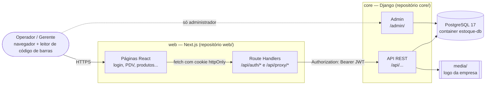
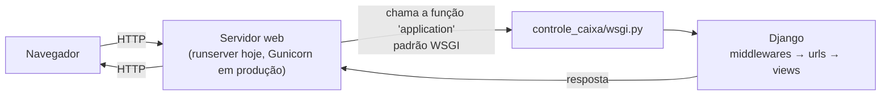
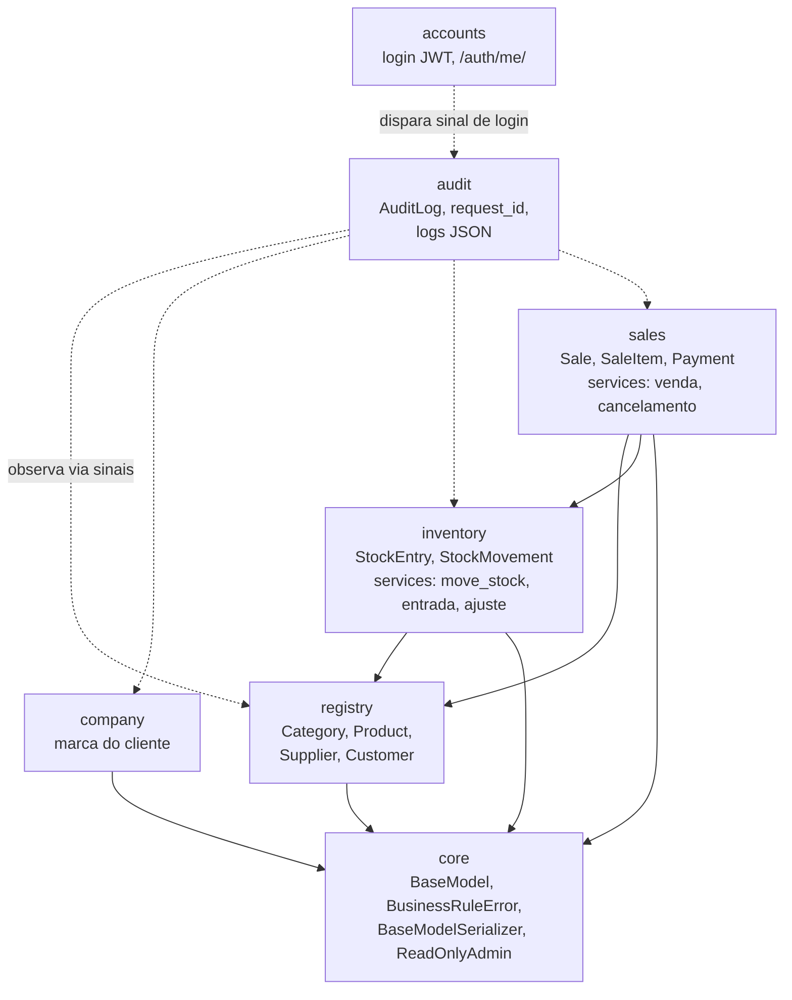
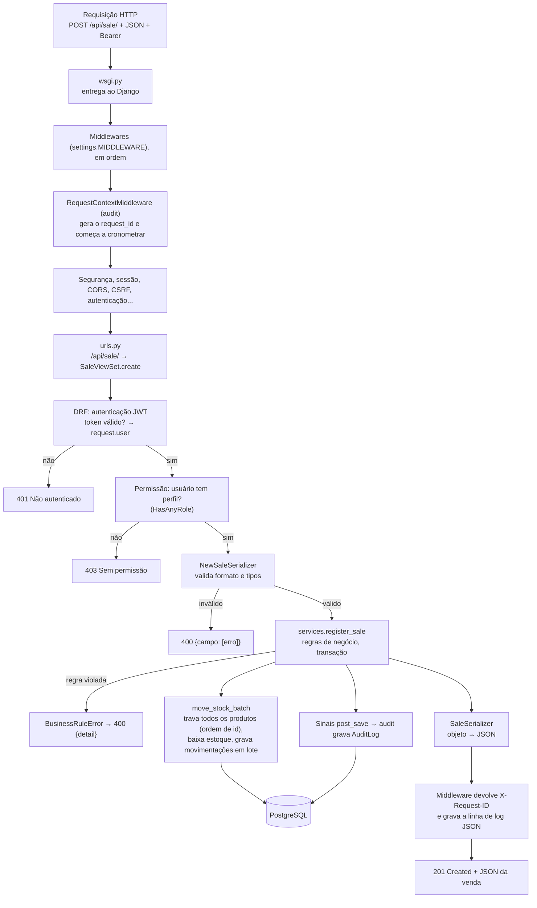
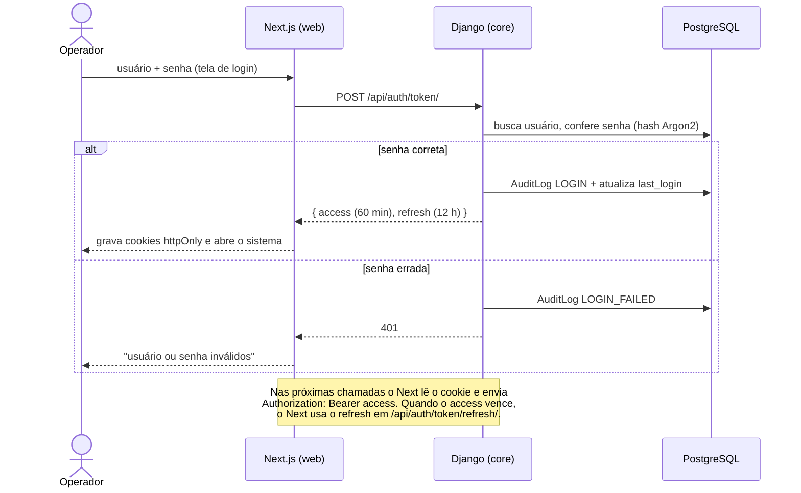
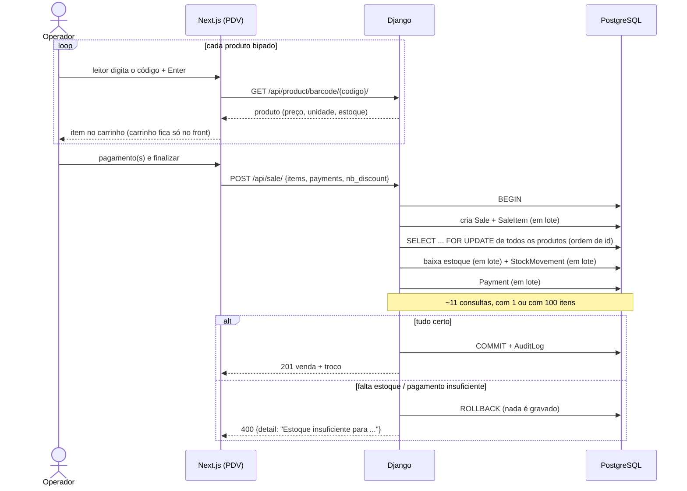
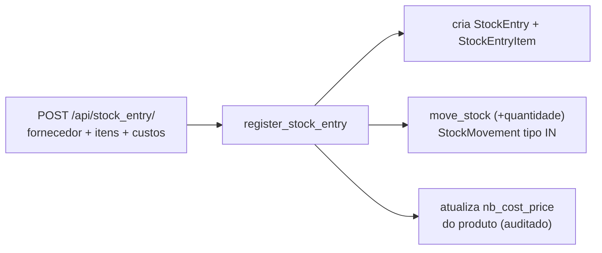
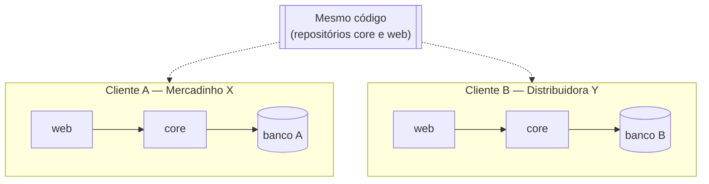

# Arquitetura do Sistema — Distribuidora

Documentação técnica de como o sistema está organizado, o que é cada pasta/arquivo e como uma requisição percorre o código.

> **Vai explicar o projeto (entrevista, apresentação)?** Comece pela [seção 10 — Roteiro para entrevista](#10-roteiro-para-entrevista): ela conta o projeto em ordem, do macro ao detalhe, com as perguntas mais prováveis e as respostas.

> Os diagramas usam **Mermaid**. No PyCharm: *Settings → Languages & Frameworks → Markdown → Mermaid* (habilitar) e abra o arquivo com a pré-visualização. No GitHub/GitLab eles aparecem desenhados automaticamente.

---

## 1. Que tipo de arquitetura é esta?

| Pergunta | Resposta | Em uma frase |
|---|---|---|
| Monolito ou microsserviços? | **Monolito modular** | Um único back-end Django, dividido internamente em módulos (apps) com responsabilidades separadas. |
| Monorepo ou multirrepo? | **Multirrepo (polyrepo)** | `core/` (back) e `web/` (front) são **dois repositórios git independentes**. |
| Como o front fala com o back? | **API REST + BFF** | O front (Next.js) chama a API JSON do Django através de um proxy no próprio servidor do Next (*Backend for Frontend*). |
| Um banco para todos os clientes? | **Não — single-tenant** | Cada cliente (mercadinho/distribuidora) recebe **sua própria instalação**: containers, banco e `.env` próprios. |

### Monolito modular — o que significa

- **Monolito**: todo o back-end é **um processo só**, com **um banco só**. Venda, estoque e cadastro rodam juntos e se chamam por funções Python, não pela rede.
- **Modular**: por dentro ele é separado em *apps* (`registry`, `inventory`, `sales`...). Cada app cuida de um assunto e tem seus próprios arquivos.

**Por que não microsserviços?** Microsserviços (um serviço e um banco por assunto, conversando por rede) resolvem problemas de empresas com muitas equipes e escala gigante. Aqui só trariam custo: várias implantações, transações distribuídas (a venda precisa baixar o estoque *junto*, na mesma transação), mais pontos de falha. Se um dia um módulo precisar virar serviço separado, a divisão em apps já deixa a fronteira desenhada.

### Multirrepo — o que significa

```
distribuidora/
├── core/   ← repositório git do back-end (Django)
└── web/    ← repositório git do front-end (Next.js)
```

A pasta `distribuidora/` **não** é um repositório; cada subpasta tem seu próprio `.git`, histórico e versão.

| | Multirrepo (atual) | Monorepo (alternativa) |
|---|---|---|
| Histórico | Separado por projeto | Um só para tudo |
| Mudança que mexe nos dois lados | Dois commits, em dois repositórios | Um commit só |
| Permissões | Dá para dar acesso só ao front, por exemplo | Todo mundo vê tudo |
| CI/CD | Pipeline independente para cada um | Um pipeline que precisa saber o que mudou |

O que **liga** os dois repositórios é o **contrato da API**: o schema OpenAPI em `/api/schema/`. O front gera os tipos TypeScript a partir dele (`npm run gen:api`), então, se o back muda um campo, o front acusa erro de tipo.

---

## 2. Visão geral — os containers e o caminho dos dados



**Por que o navegador não fala direto com o Django?** Os tokens JWT ficam num **cookie httpOnly**, que o JavaScript da página não consegue ler. Isso protege contra roubo de token por scripts maliciosos (XSS). O servidor do Next lê o cookie, coloca o `Bearer` no cabeçalho e repassa para o Django. Esse intermediário é o **BFF** (*Backend for Frontend*).

### Containers (Podman)

| Container | Imagem | Porta | Papel |
|---|---|---|---|
| `estoque-db` | `docker/database/Dockerfile` (Postgres 17, fuso de Manaus) | 5432 | Banco de dados. Dados no volume `postgres_data`. |
| `estoque-backend` | `docker/backend/Dockerfile` (Python 3.13) | 8000 | Django: API, admin e documentação. Roda `migrate` ao iniciar (`entrypoint.sh`). |
| *(front)* | *(ainda sem container)* | 3000 | Next.js, hoje rodando com `npm run dev`. |

O `compose.yaml` sobe os dois, faz o back **esperar o banco ficar saudável** (`healthcheck`) e entrega o `.env` ao back.

---

## 3. Estrutura de pastas do back-end (`core/`)

```
core/                        ← raiz do repositório do back-end
├── manage.py                ← "controle remoto" do Django (migrate, test, runserver...)
├── requirements.txt         ← dependências Python com versão fixa
├── compose.yaml             ← sobe banco + back no Podman
├── .env / .env.example      ← segredos e configurações (o .env não vai para o git)
├── docker/
│   ├── backend/             ← Dockerfile + entrypoint.sh do Django
│   └── database/            ← Dockerfile do Postgres
│
├── controle_caixa/          ← CONFIGURAÇÃO do projeto (não é regra de negócio)
│   ├── settings.py          ← todas as configurações
│   ├── urls.py              ← mapa de URLs → código
│   ├── wsgi.py              ← porta de entrada para servidores web síncronos
│   └── asgi.py              ← porta de entrada para servidores assíncronos
│
├── core/                    ← peças COMPARTILHADAS por todos os apps
├── accounts/                ← login (JWT) e dados do usuário logado
├── company/                 ← dados e marca do cliente (logo, cor, CNPJ)
├── registry/                ← cadastros: categoria, produto, fornecedor, cliente
├── inventory/               ← estoque: entradas de mercadoria, movimentações, ajustes
├── sales/                   ← vendas, itens e pagamentos
├── audit/                   ← auditoria (quem fez o quê) e rastreamento de requisições
└── docs/                    ← esta documentação
```

> **Atenção à confusão de nomes:** existe a pasta `core/` (a raiz do repositório) e, dentro dela, o app `core/core/`. Quando esta documentação fala "app core", é o de dentro.

### 3.1 `controle_caixa/` — a configuração do projeto

É o **pacote de configuração**, criado pelo `django-admin startproject`. Não tem regra de negócio: diz *como* o sistema roda e *quais* módulos fazem parte dele. O nome vem da primeira versão do projeto (controle de caixa); poderia se chamar `config/`, e renomear é uma melhoria possível.

| Arquivo | O que faz |
|---|---|
| `settings.py` | Configurações de tudo: apps instalados, banco (lido do `.env`), middlewares, idioma `pt-br`, fuso `America/Manaus`, JWT, Argon2, CORS, logs em JSON, paginação da API. |
| `urls.py` | O **mapa** do sistema: liga cada URL ao código que responde. Ex.: `admin/` → admin do Django; `api/product/` → `ProductViewSet`. |
| `wsgi.py` | Ver abaixo. |
| `asgi.py` | Ver abaixo. |
| `__init__.py` | Marca a pasta como pacote Python (vazio). |

#### O que é o WSGI (e o ASGI)

O Django **não sabe falar HTTP sozinho** com a internet. Quem recebe a conexão do navegador é um **servidor web** (em desenvolvimento, o `runserver`; em produção, o **Gunicorn**, por exemplo). O **WSGI** (*Web Server Gateway Interface*) é o **padrão de tomada** entre esse servidor e o Django:



O `wsgi.py` só faz duas coisas: diz qual é o `settings` (`controle_caixa.settings`) e cria o objeto `application`, que o servidor chama a cada requisição.

O **ASGI** é a versão moderna e **assíncrona** do mesmo padrão. Ele é necessário para WebSockets e conexões longas (ex.: atualizar o dashboard em tempo real), usando servidores como Uvicorn ou Daphne. Hoje o projeto roda em WSGI; o `asgi.py` fica pronto para quando for preciso.

#### `manage.py`

Script de linha de comando do projeto. Ele aponta para `controle_caixa.settings` e executa os comandos do Django: `migrate`, `makemigrations`, `createsuperuser`, `test`, `shell`, `runserver`.

### 3.2 O que é um *app*

Um **app** é um módulo do sistema com um assunto só. Todos seguem a mesma receita de arquivos (o padrão adotado do modelo do instituto):

| Arquivo | Camada | Responsabilidade |
|---|---|---|
| `models.py` | Dados | Define as **tabelas** (colunas, tipos, chaves, restrições). Ex.: `Product` → tabela com `id_product`, `tx_description`, `nb_price`... |
| `migrations/` | Dados | Arquivos gerados pelo `makemigrations` com as instruções para criar/alterar as tabelas no banco. Funcionam como um **histórico de versões do banco**. |
| `serializers.py` | Entrada/saída | Converte **JSON ↔ objetos Python** e **valida** o que chega (tipos, obrigatórios, tamanhos). |
| `filters.py` | Entrada | Define os **filtros** aceitos na URL (`?tx_description=arroz&bl_active=true`). |
| `viewsets.py` | Interface HTTP | Recebe a requisição, chama serializer/service e devolve a resposta. **Fino de propósito**: não decide regra de negócio. |
| `services.py` | **Regra de negócio** | Onde ficam as decisões do negócio (ver 3.3). Só existe nos apps que têm regras: `inventory` e `sales`. |
| `admin.py` | Interface admin | Como o model aparece em `/admin/`. |
| `apps.py` | Registro | Nome e configuração do app (o `audit` usa o `ready()` para ligar os sinais). |
| `tests.py` | Qualidade | Testes automáticos. |

### 3.3 O que é o *service* (e por que ele existe)

O **service** é a camada onde mora a **regra de negócio**: as decisões que fazem do sistema um controle de estoque e não só um cadastro.

Exemplo — o que acontece numa venda (`sales/services.py → register_sale`):

1. Valida cada item: produto ativo? Quantidade fracionada só em KG/L.
2. Calcula subtotal, aplica desconto (desconto ≤ subtotal) e chega ao total.
3. Confere os pagamentos: soma ≥ total; troco só em dinheiro.
4. Grava a venda, os itens (com o **preço do momento**) e os pagamentos — itens e pagamentos **em lote** (`bulk_create`, um único `INSERT` para todos).
5. Chama `inventory/services.py → move_stock_batch` com todos os itens: ele **trava todos os produtos de uma vez** (em ordem de id), baixa o estoque (bloqueando estoque negativo) e grava as movimentações em lote.
6. Tudo dentro de **uma transação** (`@transaction.atomic`): se qualquer passo falhar, **nada** é gravado.

**Por que não colocar isso no viewset ou no model?**

- No **viewset**, a regra ficaria presa ao HTTP. Um comando agendado, uma importação ou outro endpoint teriam que copiar o código.
- No **model**, a regra que envolve várias tabelas (venda + itens + pagamentos + estoque) não tem dono natural.
- No **service**, a regra é **uma função Python comum**: chamada pela API, pelo admin, por testes ou por um script, e testada sem precisar de HTTP (é o que os testes de `sales/tests.py` fazem).

**`move_stock_batch` é a única porta do estoque.** Nenhum código altera `nb_stock` diretamente. Isso garante três coisas:

- **Histórico completo:** todo movimento vira uma linha em `StockMovement` (quem, quanto, saldo resultante, motivo).
- **Sem saldo corrompido:** `select_for_update` trava as linhas dos produtos até a transação terminar; duas vendas do mesmo produto ao mesmo tempo esperam uma pela outra em vez de sobrescrever o saldo (*lost update*).
- **Sem deadlock:** os produtos são travados **sempre em ordem de id**. Se cada venda travasse na ordem do carrinho, o caixa 1 (A depois B) e o caixa 2 (B depois A) poderiam ficar esperando um ao outro para sempre — o Postgres derrubaria uma das vendas.

`move_stock` (um produto só, usado no ajuste de inventário) é apenas um atalho para `move_stock_batch` com uma linha.

### 3.4 Cada app em detalhe



As setas mostram **quem importa quem**. A regra é: dependências apontam "para baixo" (`sales` usa `inventory`, nunca o contrário), e ninguém depende de `audit`, que só **observa** por sinais.

| App | Tabelas | Responsabilidade |
|---|---|---|
| **core** | — (só modelos abstratos) | Peças reutilizadas: `BaseModel` (colunas `dt_created_at`/`dt_modified_at` e textos em maiúsculo), `BusinessRuleError` (erro de regra → HTTP 400), tratamento de erros da API, serializer base, admin somente leitura. |
| **accounts** | usa `auth_user` e `auth_group` do Django | Login por JWT (`/api/auth/token/`), renovação (`/token/refresh/`), dados e **perfil** do usuário logado (`/auth/me/`), e as **regras de permissão** de toda a API (`roles.py`, `permissions.py` — ver seção 6.1). |
| **company** | `Company` (registro único) | Nome, CNPJ, contato, **logo** e **cor** do cliente desta instalação. Leitura pública (o front mostra a logo no login); edição só por administrador. |
| **registry** | `Category`, `Product`, `Supplier`, `Customer` | Cadastros. CRUD simples, sem service. Inclui a busca por código de barras (`/api/product/barcode/{codigo}/`). |
| **inventory** | `StockEntry`, `StockEntryItem`, `StockMovement` | Entrada de mercadoria (soma ao estoque e atualiza o custo), ajuste de inventário e histórico de tudo que mexeu no estoque. |
| **sales** | `Sale`, `SaleItem`, `Payment` | Registro de venda (baixa estoque, troco, pagamento dividido) e cancelamento (devolve ao estoque). Vendas não são editadas nem excluídas. |
| **audit** | `AuditLog` | Registra criação/alteração/exclusão (com antes→depois) e logins; dá um `request_id` a cada requisição e grava logs em JSON. |

### 3.5 Padrão de nomes das colunas

| Prefixo | Tipo | Exemplo |
|---|---|---|
| `id_` | Chave primária ou estrangeira | `id_product`, `id_category` |
| `tx_` | Texto | `tx_description`, `tx_barcode` |
| `nb_` | Número / decimal | `nb_price`, `nb_stock` |
| `dt_` | Data / data-hora | `dt_created_at`, `dt_entry` |
| `bl_` | Booleano | `bl_active` |
| `im_` | Imagem | `im_logo` |
| `js_` | JSON | `js_changes` |

Todas as colunas têm `db_column` explícito, então o nome no banco é exatamente o do código.

---

## 4. O caminho de uma requisição dentro do Django

Exemplo: o front chama `POST /api/sale/` para registrar uma venda.



**Resumo das camadas:**

```
HTTP → urls → viewset → serializer (valida) → service (decide) → model (grava) → banco
                                                     ↘ audit (observa)
```

---

## 5. Fluxos principais

### 5.1 Login (JWT + cookie httpOnly)



### 5.2 Venda no PDV



### 5.3 Entrada de mercadoria



---

## 6. Segurança e observabilidade

| Tema | Como está resolvido | Onde |
|---|---|---|
| Senhas | Hash **Argon2** (não é criptografia: não tem volta) | `settings.PASSWORD_HASHERS` |
| Autenticação da API | **JWT**: access 60 min, refresh 12 h | `settings.SIMPLE_JWT`, `accounts/` |
| Token no navegador | Cookie **httpOnly** gerenciado pelo Next (BFF) | `web/src/app/api/` |
| Autorização | **Perfis** (operador, gerente, administrador) checados em toda rota | `accounts/roles.py`, `accounts/permissions.py` (seção 6.1) |
| Validação | Nos **dois lados**: front (experiência) e back (palavra final) | `web/src/schemas/`, serializers, models (seção 6.2) |
| Segredos | `.env` fora do git; nada sensível no código | `.env`, `settings.py` |
| Integridade | Restrições no próprio Postgres (quantidade > 0, desconto ≤ subtotal, troco só em dinheiro) | `Meta.constraints` dos models |
| Concorrência | Trava de linha (`select_for_update`) em ordem de id ao mexer no estoque | `inventory/services.py` |
| Auditoria | `AuditLog` com quem, o quê, antes→depois, IP, request_id | `audit/` |
| Rastreamento | `X-Request-ID` em toda resposta + logs JSON com o mesmo ID | `audit/middleware.py`, `audit/log_format.py` |

**Autenticação × autorização:** *autenticação* responde "**quem é você?**" (login, JWT). *Autorização* responde "**o que você pode fazer?**" (perfis). São etapas diferentes: um operador está autenticado, mas não autorizado a cancelar venda.

**Como investigar um problema:** pegue o `X-Request-ID` da resposta (o front pode exibir no erro) → procure nos logs (`podman compose logs backend | Select-String "<id>"`) → consulte a auditoria (`/api/audit_log/?tx_request_id=<id>`).

### 6.1 Perfis de acesso (RBAC)

O controle é por **perfil** (*Role-Based Access Control*): a permissão é dada ao perfil, e o usuário recebe um perfil.

| Ação | Operador | Gerente | Administrador |
|---|:-:|:-:|:-:|
| Consultar produtos, categorias, fornecedores, clientes | ✅ | ✅ | ✅ |
| Criar / editar / excluir cadastros (inclui **preço**) | ❌ | ✅ | ✅ |
| Registrar venda | ✅ | ✅ | ✅ |
| Ver vendas | só as **próprias** | todas | todas |
| Cancelar venda | ❌ | ✅ | ✅ |
| Entrada de mercadoria, movimentações, ajuste | ❌ | ✅ | ✅ |
| Editar empresa (logo, cor, dados) | ❌ | ❌ | ✅ |
| Consultar auditoria | ❌ | ❌ | ✅ |

**Como funciona, passo a passo:**

1. **Perfil = grupo do Django.** Uma *data migration* (`accounts/migrations/0001_role_groups.py`) cria os grupos **Operador**, **Gerente** e **Administrador**. O administrador coloca cada usuário num grupo pelo admin.
2. **Hierarquia.** `roles.py` define a ordem `OPERATOR < MANAGER < ADMIN`; cada perfil pode tudo o que os anteriores podem. Superusuário é sempre administrador. Em mais de um grupo, vale o maior.
3. **Permissões do DRF.** `permissions.py` tem as classes `HasAnyRole`, `IsManager`, `IsAdmin` e `ReadOnlyOrManager`. Cada viewset declara a sua:
   - padrão global (`settings.DEFAULT_PERMISSION_CLASSES`): `HasAnyRole` — rota nova já nasce protegida;
   - cadastros: `ReadOnlyOrManager` (GET para todos, escrita para gerente+);
   - estoque: `IsManager`; cancelar venda: `IsManager` só na ação `cancel`;
   - empresa (edição) e auditoria: `IsAdmin`.
4. **Filtro por dono.** No `SaleViewSet.get_queryset`, o operador recebe só as vendas com `id_user` = ele mesmo. Isso não é permissão de rota, é **filtro de dados**: a rota é a mesma, o resultado muda.
5. **O front só esconde.** O `/api/auth/me/` devolve `tx_role` e o front esconde botões e telas. Mas **quem garante é o back**: chamar a API direto (Swagger, curl) sem o perfil certo retorna `403`.

#### O dono do negócio cadastra os próprios funcionários

O usuário com perfil **Administrador** (o dono) usa o admin do Django (`/admin/`) para criar funcionários e escolher o perfil de cada um:

1. **Acesso automático ao admin.** Ao entrar no grupo Administrador, o usuário ganha `is_staff` sozinho; ao sair, perde. Operador e gerente nunca entram no admin. (`accounts/admin_access.py → sync_staff_flag`, disparado pelo sinal `m2m_changed` dos grupos.)
2. **Permissões do admin definidas no código.** Após cada `migrate`, o grupo Administrador recebe as permissões de `ADMIN_GROUP_PERMISSIONS` (cadastrar/editar usuários, editar a empresa, cadastros, ver vendas, estoque e auditoria). Ninguém marca a lista à mão em cada cliente. (`sync_admin_group_permissions`, sinal `post_migrate`.)
3. **Proteção contra escalada de privilégio** (`accounts/admin.py → EmployeeAdmin`), para quem não é superusuário:
   - não vê nem edita superusuários (a conta do desenvolvedor);
   - não tem os campos "superusuário", "membro da equipe" e "permissões avulsas";
   - só pode escolher entre os 3 grupos de perfil;
   - não exclui usuários: desativa (`is_active`), preservando o histórico de vendas e auditoria.
4. **Auditado.** Toda mudança de perfil vira um registro: `{"groups": {"added": ["Gerente"]}}`, com quem fez e quando.

**Por que grupos e não um campo no usuário?** Trocar o model de usuário do Django depois do projeto começado (`AUTH_USER_MODEL`) obriga a recriar o banco. Grupos já existem, aparecem no admin e não exigem mudança de schema.

### 6.2 Validação em duas camadas

| | Front (`web/src/schemas/`, Zod) | Back (serializers, models, services) |
|---|---|---|
| Papel | **Experiência**: avisa na hora, sem ir ao servidor | **Segurança e integridade**: a palavra final |
| Pode ser burlada? | Sim — basta chamar a API direto | Não — todo dado passa por ele |
| O que valida | Obrigatórios, tamanhos, formatos, decimais | Tudo isso **+** o que só o banco sabe (código de barras repetido, estoque disponível) |

O back valida em três níveis, do mais superficial ao mais profundo:

1. **Serializer** — formato e tipos (campo obrigatório, decimal válido, tamanho) → `400 { "campo": ["mensagem"] }`.
2. **Service** — regra de negócio (estoque, troco, desconto) → `400 { "detail": "mensagem" }`.
3. **Banco** — `CheckConstraint`, `unique`, chaves estrangeiras: a última barreira, vale até para código que esqueça as camadas anteriores.

**Front e back não divergem:** cada schema do front é conferido contra os tipos gerados do OpenAPI (`satisfies z.ZodType<Input<"Product">>`). Se o back muda um campo obrigatório, o `npm run typecheck` do front falha depois do `npm run gen:api`.

---

## 7. Desempenho

### 7.1 Medições

Medido com 50 produtos e 20 vendas, no Windows falando com o Postgres no Podman:

| Operação | Antes | Depois |
|---|---:|---:|
| Listar produtos | 3 consultas | 3 consultas |
| Listar vendas (com itens e pagamentos) | 5 | 5 |
| Bipar produto (código de barras) | 1 | 1 |
| Venda com 1 item | 12 | 11 |
| Venda com 10 itens | 75 | 11 |
| **Venda com 30 itens** | **215 (444 ms)** | **11 (100 ms)** |

Há um teste automático que garante isso: `sales/tests.py → test_sale_query_count_does_not_grow_with_items` falha se a venda voltar a crescer com o número de itens.

### 7.2 O que foi feito e por quê

| Técnica | Problema que resolve | Onde |
|---|---|---|
| `select_related` / `prefetch_related` | **N+1**: listar 50 vendas faria 1 consulta para as vendas + 1 por venda para os itens. Com prefetch, são consultas fixas, independentemente da quantidade. | `queryset` dos viewsets |
| `bulk_create` / `bulk_update` | Gravar 30 itens com 30 `INSERT`s separados; vira **um** `INSERT` com 30 linhas. | `sales/services.py`, `inventory/services.py` |
| Travar todos os produtos de uma vez, **em ordem de id** | Uma consulta de trava em vez de uma por item **e** elimina deadlock entre caixas. | `move_stock_batch` |
| Índice em `dt_created_at` (vendas e movimentações) | Ordenar/filtrar por data sem percorrer a tabela inteira (dashboard, "vendas de hoje", relatórios). | `Meta.indexes` |
| Salvar custo só se mudou | Na entrada de mercadoria, `save()` (auditado) apenas nos produtos cujo custo mudou. | `_update_cost_prices` |
| Bipar = 1 consulta em campo `unique` | `unique` cria índice; a busca é direta. É a operação mais repetida do dia. | `ProductViewSet.barcode` |

**Detalhe importante do `bulk_update`:** ele grava direto no banco **sem chamar `save()`** — então não dispara sinais (auditoria) nem `auto_now`. Por isso `move_stock_batch` preenche `dt_modified_at` à mão, e por isso ele só é usado para o estoque, que já tem histórico próprio (`StockMovement`). Mudança de **preço** continua passando por `save()` para entrar na auditoria.

### 7.3 Próximos passos de desempenho

- **Produção:** trocar `runserver` por **Gunicorn** com vários *workers* (atende vários caixas em paralelo) e `DEBUG=False` (o modo debug guarda toda consulta em memória).
- **Busca por nome com catálogo grande:** `icontains` percorre a tabela; acima de dezenas de milhares de produtos, um índice `pg_trgm` (GIN) no Postgres resolve.
- **Retenção da auditoria:** a tabela só cresce; definir por quanto tempo guardar e arquivar o resto.

---

## 8. Implantação: uma instalação por cliente



- **White-label:** o produto é o mesmo; cada cliente vê **a própria marca** (nome, logo e cor vêm de `Company`, nada fixo no código).
- **Single-tenant:** cada cliente tem **a própria instalação e o próprio banco**. O que muda entre clientes é o `.env` (chave, senha do banco, domínio) e os dados.
- **Vantagens:** isolamento total dos dados (um cliente nunca enxerga o outro), backup e restauração por cliente, atualização cliente a cliente.
- **Custo:** cada instalação precisa ser atualizada e monitorada. Com muitos clientes, vale automatizar a implantação.

White-label e multi-tenant são coisas diferentes: *white-label* responde "com a marca de quem?"; *multi-tenant* responde "quantos clientes dividem a mesma instalação?". Aqui é white-label **e** single-tenant.

### Pendências para produção

- Trocar `runserver` por **Gunicorn** (WSGI) atrás de **nginx/Caddy** com **HTTPS**.
- `DEBUG=False`, `ALLOWED_HOSTS` com o domínio do cliente.
- Volume para `media/` (logo) e **backup automático** do Postgres.
- Container do front (`web`) no compose.

---

## 9. Glossário

| Termo | Significado |
|---|---|
| **API REST** | Interface em que o front pede e envia dados em JSON por URLs (`GET /api/product/`). |
| **App (Django)** | Módulo do sistema com um assunto (ex.: `sales`). |
| **ASGI / WSGI** | Padrões de conexão entre o servidor web e o Django (assíncrono / síncrono). |
| **Autenticação / autorização** | "Quem é você?" (login) / "O que você pode fazer?" (perfil). |
| **BFF** | *Backend for Frontend*: servidor intermediário do front (aqui, os Route Handlers do Next) que guarda o token e repassa as chamadas. |
| **Bulk (create/update)** | Gravar muitas linhas num único comando SQL, em vez de um por linha. |
| **CORS** | Regra do navegador que bloqueia chamadas a outro domínio sem autorização. Com o BFF, o navegador só fala com o próprio Next. |
| **Data migration** | Migração que mexe em **dados** (ex.: criar os grupos de perfil), não na estrutura das tabelas. |
| **Deadlock** | Duas transações esperando uma pela outra para sempre; o banco derruba uma. Evitado travando sempre na mesma ordem. |
| **DRF** | Django REST Framework: biblioteca que transforma o Django em API REST. |
| **Índice** | Estrutura do banco que acelera buscas e ordenações por uma coluna (como o índice de um livro). |
| **JWT** | Token assinado que prova quem é o usuário em cada requisição. |
| **Lost update** | Duas operações leem o mesmo saldo e uma sobrescreve a outra. Evitado com `select_for_update`. |
| **Middleware** | Código que roda em **toda** requisição, antes e depois da view (ex.: gerar o `request_id`). |
| **Migration** | Arquivo com as instruções para criar/alterar tabelas; versiona o banco. Vai para o git. |
| **Model** | Classe Python que representa uma tabela. |
| **Monolito modular** | Um único sistema/processo, organizado internamente em módulos independentes. |
| **Multirrepo** | Cada projeto (back, front) num repositório git próprio. |
| **N+1** | Fazer 1 consulta para a lista + 1 para cada item dela. Resolvido com `select_related`/`prefetch_related`. |
| **OpenAPI** | Descrição padronizada da API (`/api/schema/`); gera o Swagger e os tipos do front. |
| **RBAC** | *Role-Based Access Control*: permissões dadas a perfis, e perfis dados a usuários. |
| **`select_for_update`** | Trava as linhas lidas até o fim da transação; outra transação que queira as mesmas linhas espera. |
| **Serializer** | Converte JSON ↔ objeto e valida a entrada. |
| **Service** | Função com a regra de negócio, independente de HTTP. |
| **Sinal (signal)** | Aviso que o Django dispara em eventos (salvou, excluiu, logou). O `audit` escuta esses avisos. |
| **Single-tenant** | Uma instalação (e um banco) por cliente. |
| **Transação** | Conjunto de operações no banco que acontece por inteiro ou não acontece. |
| **Viewset** | Classe que agrupa as ações HTTP de um recurso (listar, criar, detalhar...). |
| **White-label** | Mesmo produto entregue a vários clientes, cada um com a própria marca. |

---

## 10. Roteiro para entrevista

Uma ordem para contar o projeto, do macro ao detalhe. Cada passo tem o que dizer e onde está no código, caso peçam para mostrar.

### Passo 1 — O problema (30 segundos)

> "É um sistema de **vendas e controle de estoque para mercadinhos e distribuidoras**. O operador vende pelo PDV com leitor de código de barras; o gerente cadastra produtos, dá entrada nas notas dos fornecedores e acompanha o estoque; o administrador configura a empresa. É **white-label**: o mesmo produto é vendido para vários negócios, cada um com a própria marca."

### Passo 2 — A arquitetura (1 minuto)

> "São dois projetos em **repositórios separados**: o back em **Django + Django REST Framework** com **PostgreSQL**, e o front em **Next.js**. O back é um **monolito modular**: um processo, um banco, dividido em apps por assunto — cadastros, estoque, vendas, auditoria, contas. Cada cliente tem **a própria instalação e o próprio banco** (single-tenant), e tudo roda em containers com **Podman**."

Se perguntarem **por que não microsserviços**: "A venda precisa baixar o estoque **na mesma transação**. Com microsserviços isso viraria uma transação distribuída, mais complexa e mais frágil, sem ganho para o tamanho do problema. A divisão em apps já deixa as fronteiras prontas se um dia algum módulo precisar sair."

Mostrar: seção 2 (diagrama dos containers) e a pasta `core/`.

### Passo 3 — A organização do código (1 minuto)

> "Cada app segue a mesma receita: `models` (tabelas), `serializers` (valida e converte JSON), `filters`, `viewsets` (a camada HTTP, fina de propósito) e `services` (a **regra de negócio**). O caminho de uma requisição é: **urls → viewset → serializer → service → model → banco**."

Por que **services**: "Para a regra não depender de HTTP. A mesma função `register_sale` é usada pela API, pelos testes e por qualquer script — e é testada sem precisar de requisição."

Mostrar: seção 4 (fluxograma da requisição), `sales/services.py`.

### Passo 4 — O fluxo mais importante: a venda (2 minutos)

> "O front monta o carrinho bipando produtos — cada bipe é **uma consulta** por código de barras, que é um campo único e indexado. Ao finalizar, manda tudo de uma vez em `POST /api/sale/`. No back:"

1. O **serializer** valida o formato.
2. O **service** valida as regras: produto ativo, quantidade quebrada só em KG/L, desconto ≤ subtotal, pagamento ≥ total, troco só em dinheiro.
3. Grava venda, itens (com o **preço do momento**, para relatórios antigos não mudarem) e pagamentos **em lote**.
4. **Trava todos os produtos de uma vez, em ordem de id**, baixa o estoque e grava as movimentações.
5. Tudo numa **transação**: faltou estoque de um item, **nada** é gravado.

> "Isso custa **11 consultas**, seja com 1 ou com 100 itens."

Mostrar: seção 5.2 (diagrama da venda).

### Passo 5 — Concorrência (o diferencial técnico)

> "Dois caixas vendendo o mesmo produto ao mesmo tempo: se os dois lerem o saldo 10 e cada um gravar 9, perdi uma baixa (*lost update*). Resolvo com `select_for_update`, que trava a linha até o fim da transação. E travo **sempre em ordem de id**: se o caixa 1 travasse A e depois B, e o caixa 2 travasse B e depois A, um esperaria o outro para sempre — um **deadlock**. Com a ordem fixa, isso não acontece."

Mostrar: `inventory/services.py → move_stock_batch`.

### Passo 6 — Segurança (1 minuto)

- **Senhas** com hash **Argon2** (hash não é criptografia: não tem volta).
- **Login JWT** (access de 60 min, refresh de 12 h). No front, o token fica em **cookie httpOnly** e o Next faz de **BFF**: o JavaScript da página nunca vê o token, o que protege contra XSS.
- **Perfis (RBAC)**: operador, gerente, administrador, aplicados **no back** em toda rota. O padrão global exige perfil, então uma rota nova já nasce protegida. O front só esconde botões.
- **Validação nos dois lados**: no front para a experiência, no back porque o front pode ser burlado — e o banco tem `CheckConstraint` como última barreira.
- **Segredos** no `.env`, fora do git.

Mostrar: seções 6, 6.1 e 6.2.

### Passo 7 — Observabilidade (30 segundos)

> "Toda requisição recebe um **request ID**, que volta no cabeçalho `X-Request-ID`, aparece nos **logs em JSON** e em cada registro de **auditoria**. A auditoria guarda quem criou, alterou ou excluiu o quê, com o valor **antes e depois**, IP e logins — inclusive os que falharam. Se um operador reclama de um erro, com o ID eu acho tudo o que aconteceu naquela requisição."

Mostrar: `audit/`, seção 6.

### Passo 8 — Desempenho (30 segundos)

> "Medi as rotas contando consultas ao banco. As listagens usam `select_related`/`prefetch_related` para evitar **N+1**. A venda de 30 itens caía em 215 consultas; com gravação em lote e trava única caiu para **11**, e há um teste que falha se voltar a crescer. Também criei índices nas datas para o dashboard e os relatórios."

Mostrar: seção 7.

### Passo 9 — Qualidade e próximos passos

- **Testes automáticos** cobrindo regras de venda e estoque, permissões de cada perfil, auditoria, login e número de consultas.
- **Próximos passos honestos:** Gunicorn + HTTPS em produção, backup automático, endpoints do dashboard e relatórios, limite de desconto por perfil, validação de CPF/CNPJ.

Mostrar os próximos passos é bom sinal: mostra que você sabe o que falta e por quê.

### Perguntas prováveis — respostas curtas

| Pergunta | Resposta |
|---|---|
| **O que é o `wsgi.py`?** | A "tomada" entre o servidor web (Gunicorn, runserver) e o Django. O servidor chama a função `application` a cada requisição. O `asgi.py` é a versão assíncrona, para WebSocket/tempo real. |
| **O que é o `controle_caixa/`?** | O pacote de **configuração** do projeto: `settings.py`, `urls.py`, `wsgi.py`, `asgi.py`. Não tem regra de negócio. |
| **O que é o app `core`?** | Peças compartilhadas: `BaseModel` (datas de criação/alteração, textos em maiúsculo), o erro de regra de negócio, o serializer base e o admin somente leitura. |
| **Por que o service existe?** | Para isolar a regra de negócio do HTTP: reutilizável e testável sem requisição. O viewset só recebe, chama e responde. |
| **Monorepo ou multirrepo?** | Multirrepo: back e front em repositórios separados, ligados pelo contrato da API (OpenAPI). |
| **Monolito ou microsserviços?** | Monolito modular: um processo e um banco, dividido em apps. A venda e o estoque precisam da mesma transação. |
| **Como garante que dois caixas não estragam o estoque?** | `select_for_update` dentro de uma transação, travando em ordem de id (evita lost update e deadlock). |
| **E se faltar estoque no meio da venda?** | A transação é desfeita inteira; nada é gravado e o front recebe `400` com a mensagem do produto. |
| **Por que gravar o preço no item da venda?** | Para o histórico não mudar quando o preço do produto mudar. Relatório de ontem continua mostrando o preço de ontem. |
| **O que é N+1 e como evitou?** | Uma consulta para a lista e mais uma por item. Evitado com `select_related` (FK, via JOIN) e `prefetch_related` (listas, numa consulta extra só). |
| **Por que validar no back se o front já valida?** | Porque o front pode ser ignorado: qualquer um chama a API direto. O front é experiência; o back é segurança. |
| **Autenticação × autorização?** | Autenticação = quem é você (JWT). Autorização = o que pode fazer (perfil). |
| **Como o cliente gerencia os funcionários?** | Pelo admin do Django, com o perfil Administrador. O acesso ao admin e as permissões são dados automaticamente pelo código; ele não consegue virar superusuário, ver a conta do desenvolvedor nem dar grupos fora dos 3 perfis. Cada troca de perfil é auditada. |
| **O que é escalada de privilégio?** | Um usuário conseguir mais poder do que deveria (ex.: o dono se dar superusuário). Bloqueado escondendo esses campos e filtrando os grupos e usuários visíveis no admin. |
| **Por que o token fica em cookie httpOnly?** | O JavaScript da página não consegue ler esse cookie; um script malicioso (XSS) não rouba o token. |
| **Hash ou criptografia nas senhas?** | Hash (Argon2): não tem volta. No login, aplica-se o hash na senha digitada e compara-se. |
| **As migrations vão para o git?** | Sim, sempre. São o histórico do banco; sem elas, cada ambiente geraria tabelas diferentes. |
| **White-label ou multi-tenant?** | White-label (marca por cliente) e single-tenant (uma instalação por cliente). |
| **Como você depura um erro em produção?** | Pego o `X-Request-ID` da resposta, procuro nos logs JSON e na auditoria pelo mesmo ID. |
| **O que falta para produção?** | Gunicorn + nginx/Caddy com HTTPS, `DEBUG=False`, backup automático do Postgres, volume para as logos, container do front. |
