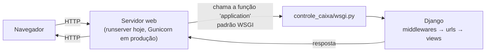
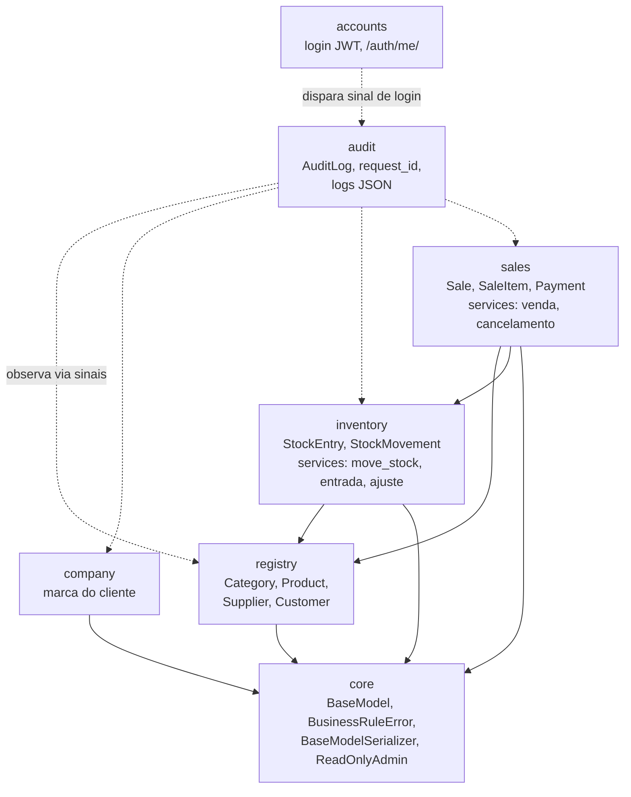
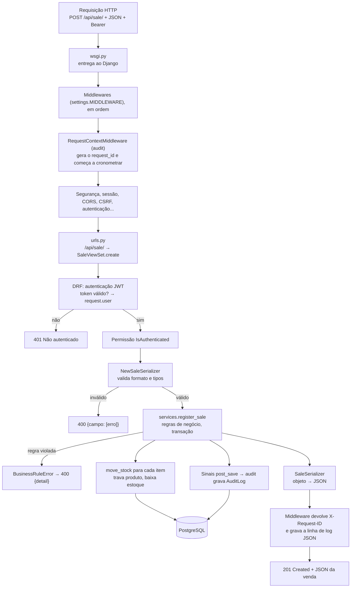
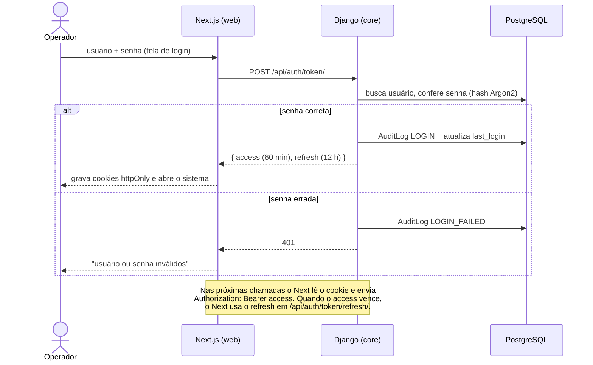
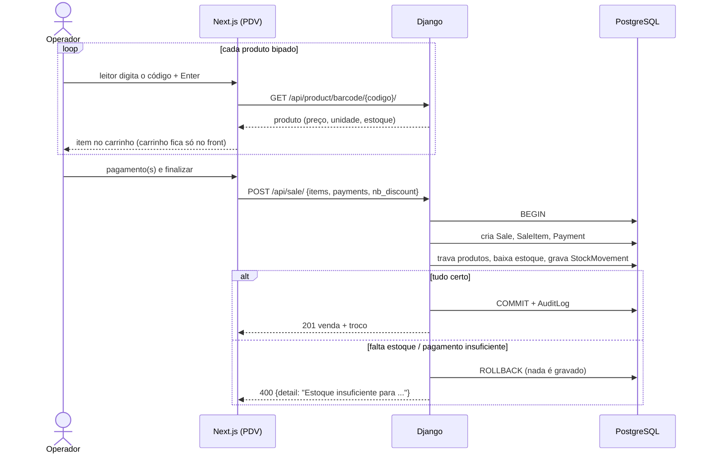
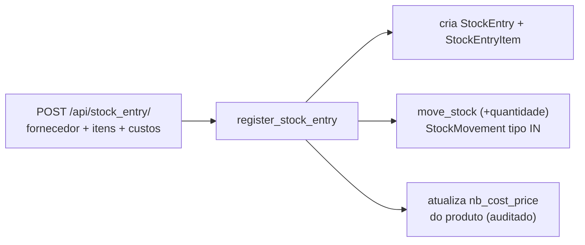
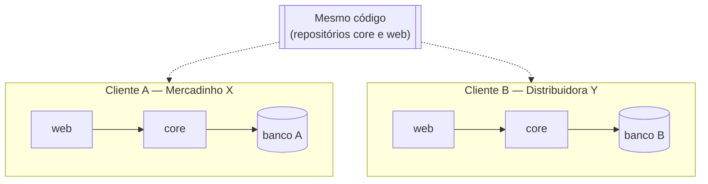

# Arquitetura do Sistema — Distribuidora

Documentação técnica de como o sistema está organizado, o que é cada pasta/arquivo e como uma requisição percorre o código.

> Os diagramas usam **Mermaid**. No PyCharm: *Settings → Languages & Frameworks → Markdown → Mermaid* (habilitar) e abra o arquivo com a pré-visualização. No GitHub/GitLab eles aparecem desenhados automaticamente.

---

## 1. Que tipo de arquitetura é esta?

| Pergunta | Resposta | Em uma frase |
|---|---|---|
| Monolito ou microsserviços? | **Monolito modular** | Um único back-end Django, dividido internamente em módulos (apps) com responsabilidades separadas. |
| Monorepo ou multirrepo? | **Multirrepo (polyrepo)** | `core/` (back) e `web/` (front) são **dois repositórios git independentes**. |
| Como o front fala com o back? | **API REST + BFF** | O front (Next.js) chama a API JSON do Django através de um proxy no próprio servidor do Next (*Backend for Frontend*). |
| Um banco para todos os clientes? | **Não — single-tenant** | Cada cliente (mercadinho/distribuidora) recebe **sua própria instalação**: containers, banco e `.env` próprios. |

### Monolito modular — o que significa

- **Monolito**: todo o back-end é **um processo só**, com **um banco só**. Venda, estoque e cadastro rodam juntos e se chamam por funções Python, não pela rede.
- **Modular**: por dentro ele é separado em *apps* (`registry`, `inventory`, `sales`...). Cada app cuida de um assunto e tem seus próprios arquivos.

**Por que não microsserviços?** Microsserviços (um serviço e um banco por assunto, conversando por rede) resolvem problemas de empresas com muitas equipes e escala gigante. Aqui só trariam custo: várias implantações, transações distribuídas (a venda precisa baixar o estoque *junto*, na mesma transação), mais pontos de falha. Se um dia um módulo precisar virar serviço separado, a divisão em apps já deixa a fronteira desenhada.

### Multirrepo — o que significa

```
distribuidora/
├── core/   ← repositório git do back-end (Django)
└── web/    ← repositório git do front-end (Next.js)
```

A pasta `distribuidora/` **não** é um repositório; cada subpasta tem seu próprio `.git`, histórico e versão.

| | Multirrepo (atual) | Monorepo (alternativa) |
|---|---|---|
| Histórico | Separado por projeto | Um só para tudo |
| Mudança que mexe nos dois lados | Dois commits, em dois repositórios | Um commit só |
| Permissões | Dá para dar acesso só ao front, por exemplo | Todo mundo vê tudo |
| CI/CD | Pipeline independente para cada um | Um pipeline que precisa saber o que mudou |

O que **liga** os dois repositórios é o **contrato da API**: o schema OpenAPI em `/api/schema/`. O front gera os tipos TypeScript a partir dele (`npm run gen:api`), então, se o back muda um campo, o front acusa erro de tipo.

---

## 2. Visão geral — os containers e o caminho dos dados


**Por que o navegador não fala direto com o Django?** Os tokens JWT ficam num **cookie httpOnly**, que o JavaScript da página não consegue ler. Isso protege contra roubo de token por scripts maliciosos (XSS). O servidor do Next lê o cookie, coloca o `Bearer` no cabeçalho e repassa para o Django. Esse intermediário é o **BFF** (*Backend for Frontend*).

### Containers (Podman)

| Container | Imagem | Porta | Papel |
|---|---|---|---|
| `estoque-db` | `docker/database/Dockerfile` (Postgres 17, fuso de Manaus) | 5432 | Banco de dados. Dados no volume `postgres_data`. |
| `estoque-backend` | `docker/backend/Dockerfile` (Python 3.13) | 8000 | Django: API, admin e documentação. Roda `migrate` ao iniciar (`entrypoint.sh`). |
| *(front)* | *(ainda sem container)* | 3000 | Next.js, hoje rodando com `npm run dev`. |

O `compose.yaml` sobe os dois, faz o back **esperar o banco ficar saudável** (`healthcheck`) e entrega o `.env` ao back.

---

## 3. Estrutura de pastas do back-end (`core/`)

```
core/                        ← raiz do repositório do back-end
├── manage.py                ← "controle remoto" do Django (migrate, test, runserver...)
├── requirements.txt         ← dependências Python com versão fixa
├── compose.yaml             ← sobe banco + back no Podman
├── .env / .env.example      ← segredos e configurações (o .env não vai para o git)
├── docker/
│   ├── backend/             ← Dockerfile + entrypoint.sh do Django
│   └── database/            ← Dockerfile do Postgres
│
├── controle_caixa/          ← CONFIGURAÇÃO do projeto (não é regra de negócio)
│   ├── settings.py          ← todas as configurações
│   ├── urls.py              ← mapa de URLs → código
│   ├── wsgi.py              ← porta de entrada para servidores web síncronos
│   └── asgi.py              ← porta de entrada para servidores assíncronos
│
├── core/                    ← peças COMPARTILHADAS por todos os apps
├── accounts/                ← login (JWT) e dados do usuário logado
├── company/                 ← dados e marca do cliente (logo, cor, CNPJ)
├── registry/                ← cadastros: categoria, produto, fornecedor, cliente
├── inventory/               ← estoque: entradas de mercadoria, movimentações, ajustes
├── sales/                   ← vendas, itens e pagamentos
├── audit/                   ← auditoria (quem fez o quê) e rastreamento de requisições
└── docs/                    ← esta documentação
```

> **Atenção à confusão de nomes:** existe a pasta `core/` (a raiz do repositório) e, dentro dela, o app `core/core/`. Quando esta documentação fala "app core", é o de dentro.

### 3.1 `controle_caixa/` — a configuração do projeto

É o **pacote de configuração**, criado pelo `django-admin startproject`. Não tem regra de negócio: diz *como* o sistema roda e *quais* módulos fazem parte dele. O nome vem da primeira versão do projeto (controle de caixa); poderia se chamar `config/`, e renomear é uma melhoria possível.

| Arquivo | O que faz |
|---|---|
| `settings.py` | Configurações de tudo: apps instalados, banco (lido do `.env`), middlewares, idioma `pt-br`, fuso `America/Manaus`, JWT, Argon2, CORS, logs em JSON, paginação da API. |
| `urls.py` | O **mapa** do sistema: liga cada URL ao código que responde. Ex.: `admin/` → admin do Django; `api/product/` → `ProductViewSet`. |
| `wsgi.py` | Ver abaixo. |
| `asgi.py` | Ver abaixo. |
| `__init__.py` | Marca a pasta como pacote Python (vazio). |

#### O que é o WSGI (e o ASGI)

O Django **não sabe falar HTTP sozinho** com a internet. Quem recebe a conexão do navegador é um **servidor web** (em desenvolvimento, o `runserver`; em produção, o **Gunicorn**, por exemplo). O **WSGI** (*Web Server Gateway Interface*) é o **padrão de tomada** entre esse servidor e o Django:



O `wsgi.py` só faz duas coisas: diz qual é o `settings` (`controle_caixa.settings`) e cria o objeto `application`, que o servidor chama a cada requisição.

O **ASGI** é a versão moderna e **assíncrona** do mesmo padrão. Ele é necessário para WebSockets e conexões longas (ex.: atualizar o dashboard em tempo real), usando servidores como Uvicorn ou Daphne. Hoje o projeto roda em WSGI; o `asgi.py` fica pronto para quando for preciso.

#### `manage.py`

Script de linha de comando do projeto. Ele aponta para `controle_caixa.settings` e executa os comandos do Django: `migrate`, `makemigrations`, `createsuperuser`, `test`, `shell`, `runserver`.

### 3.2 O que é um *app*

Um **app** é um módulo do sistema com um assunto só. Todos seguem a mesma receita de arquivos (o padrão adotado do modelo do instituto):

| Arquivo | Camada | Responsabilidade |
|---|---|---|
| `models.py` | Dados | Define as **tabelas** (colunas, tipos, chaves, restrições). Ex.: `Product` → tabela com `id_product`, `tx_description`, `nb_price`... |
| `migrations/` | Dados | Arquivos gerados pelo `makemigrations` com as instruções para criar/alterar as tabelas no banco. Funcionam como um **histórico de versões do banco**. |
| `serializers.py` | Entrada/saída | Converte **JSON ↔ objetos Python** e **valida** o que chega (tipos, obrigatórios, tamanhos). |
| `filters.py` | Entrada | Define os **filtros** aceitos na URL (`?tx_description=arroz&bl_active=true`). |
| `viewsets.py` | Interface HTTP | Recebe a requisição, chama serializer/service e devolve a resposta. **Fino de propósito**: não decide regra de negócio. |
| `services.py` | **Regra de negócio** | Onde ficam as decisões do negócio (ver 3.3). Só existe nos apps que têm regras: `inventory` e `sales`. |
| `admin.py` | Interface admin | Como o model aparece em `/admin/`. |
| `apps.py` | Registro | Nome e configuração do app (o `audit` usa o `ready()` para ligar os sinais). |
| `tests.py` | Qualidade | Testes automáticos. |

### 3.3 O que é o *service* (e por que ele existe)

O **service** é a camada onde mora a **regra de negócio**: as decisões que fazem do sistema um controle de estoque e não só um cadastro.

Exemplo — o que acontece numa venda (`sales/services.py → register_sale`):

1. Valida cada item: produto ativo? Quantidade fracionada só em KG/L.
2. Calcula subtotal, aplica desconto (desconto ≤ subtotal) e chega ao total.
3. Confere os pagamentos: soma ≥ total; troco só em dinheiro.
4. Grava a venda, os itens (com o **preço do momento**) e os pagamentos.
5. Para cada item, chama `inventory/services.py → move_stock`, que **trava o produto**, baixa o estoque (bloqueando estoque negativo) e grava a movimentação.
6. Tudo dentro de **uma transação** (`@transaction.atomic`): se qualquer passo falhar, **nada** é gravado.

**Por que não colocar isso no viewset ou no model?**

- No **viewset**, a regra ficaria presa ao HTTP. Um comando agendado, uma importação ou outro endpoint teriam que copiar o código.
- No **model**, a regra que envolve várias tabelas (venda + itens + pagamentos + estoque) não tem dono natural.
- No **service**, a regra é **uma função Python comum**: chamada pela API, pelo admin, por testes ou por um script, e testada sem precisar de HTTP (é o que os testes de `sales/tests.py` fazem).

**`move_stock` é a única porta do estoque.** Nenhum código altera `nb_stock` diretamente. Assim todo movimento fica no histórico (`StockMovement`) e duas vendas simultâneas do mesmo produto não corrompem o saldo (`select_for_update` trava a linha).

### 3.4 Cada app em detalhe



As setas mostram **quem importa quem**. A regra é: dependências apontam "para baixo" (`sales` usa `inventory`, nunca o contrário), e ninguém depende de `audit`, que só **observa** por sinais.

| App | Tabelas | Responsabilidade |
|---|---|---|
| **core** | — (só modelos abstratos) | Peças reutilizadas: `BaseModel` (colunas `dt_created_at`/`dt_modified_at` e textos em maiúsculo), `BusinessRuleError` (erro de regra → HTTP 400), tratamento de erros da API, serializer base, admin somente leitura. |
| **accounts** | usa `auth_user` do Django | Login por JWT (`/api/auth/token/`), renovação (`/token/refresh/`) e dados do usuário logado (`/auth/me/`). |
| **company** | `Company` (registro único) | Nome, CNPJ, contato, **logo** e **cor** do cliente desta instalação. Leitura pública (o front mostra a logo no login); edição só por administrador. |
| **registry** | `Category`, `Product`, `Supplier`, `Customer` | Cadastros. CRUD simples, sem service. Inclui a busca por código de barras (`/api/product/barcode/{codigo}/`). |
| **inventory** | `StockEntry`, `StockEntryItem`, `StockMovement` | Entrada de mercadoria (soma ao estoque e atualiza o custo), ajuste de inventário e histórico de tudo que mexeu no estoque. |
| **sales** | `Sale`, `SaleItem`, `Payment` | Registro de venda (baixa estoque, troco, pagamento dividido) e cancelamento (devolve ao estoque). Vendas não são editadas nem excluídas. |
| **audit** | `AuditLog` | Registra criação/alteração/exclusão (com antes→depois) e logins; dá um `request_id` a cada requisição e grava logs em JSON. |

### 3.5 Padrão de nomes das colunas

| Prefixo | Tipo | Exemplo |
|---|---|---|
| `id_` | Chave primária ou estrangeira | `id_product`, `id_category` |
| `tx_` | Texto | `tx_description`, `tx_barcode` |
| `nb_` | Número / decimal | `nb_price`, `nb_stock` |
| `dt_` | Data / data-hora | `dt_created_at`, `dt_entry` |
| `bl_` | Booleano | `bl_active` |
| `im_` | Imagem | `im_logo` |
| `js_` | JSON | `js_changes` |

Todas as colunas têm `db_column` explícito, então o nome no banco é exatamente o do código.

---

## 4. O caminho de uma requisição dentro do Django

Exemplo: o front chama `POST /api/sale/` para registrar uma venda.



**Resumo das camadas:**

```
HTTP → urls → viewset → serializer (valida) → service (decide) → model (grava) → banco
                                                     ↘ audit (observa)
```

---

## 5. Fluxos principais

### 5.1 Login (JWT + cookie httpOnly)



### 5.2 Venda no PDV



### 5.3 Entrada de mercadoria



---

## 6. Segurança e observabilidade

| Tema | Como está resolvido | Onde |
|---|---|---|
| Senhas | Hash **Argon2** (não é criptografia: não tem volta) | `settings.PASSWORD_HASHERS` |
| Autenticação da API | **JWT**: access 60 min, refresh 12 h | `settings.SIMPLE_JWT`, `accounts/` |
| Token no navegador | Cookie **httpOnly** gerenciado pelo Next (BFF) | `web/src/app/api/` |
| Permissões | Tudo exige login; auditoria e marca (edição) só administrador | `DEFAULT_PERMISSION_CLASSES`, viewsets |
| Segredos | `.env` fora do git; nada sensível no código | `.env`, `settings.py` |
| Integridade | Restrições no próprio Postgres (quantidade > 0, desconto ≤ subtotal, troco só em dinheiro) | `Meta.constraints` dos models |
| Concorrência | Trava de linha (`select_for_update`) ao mexer no estoque | `inventory/services.py` |
| Auditoria | `AuditLog` com quem, o quê, antes→depois, IP, request_id | `audit/` |
| Rastreamento | `X-Request-ID` em toda resposta + logs JSON com o mesmo ID | `audit/middleware.py`, `audit/log_format.py` |

**Como investigar um problema:** pegue o `X-Request-ID` da resposta (o front pode exibir no erro) → procure nos logs (`podman compose logs backend | Select-String "<id>"`) → consulte a auditoria (`/api/audit_log/?tx_request_id=<id>`).

---

## 7. Implantação: uma instalação por cliente



- **Mesmo código, instalações separadas.** O que muda entre clientes é só o `.env` (chave, senha do banco, domínio) e os dados (incluindo nome, logo e cor em **Empresa**, no admin).
- **Vantagens:** isolamento total dos dados (um cliente nunca enxerga o outro), backup e restauração por cliente, atualização cliente a cliente.
- **Custo:** cada instalação precisa ser atualizada e monitorada. Com muitos clientes, vale automatizar a implantação.

### Pendências para produção

- Trocar `runserver` por **Gunicorn** (WSGI) atrás de **nginx/Caddy** com **HTTPS**.
- `DEBUG=False`, `ALLOWED_HOSTS` com o domínio do cliente.
- Volume para `media/` (logo) e **backup automático** do Postgres.
- Container do front (`web`) no compose.

---

## 8. Glossário

| Termo | Significado |
|---|---|
| **API REST** | Interface em que o front pede e envia dados em JSON por URLs (`GET /api/product/`). |
| **App (Django)** | Módulo do sistema com um assunto (ex.: `sales`). |
| **ASGI / WSGI** | Padrões de conexão entre o servidor web e o Django (assíncrono / síncrono). |
| **BFF** | *Backend for Frontend*: servidor intermediário do front (aqui, os Route Handlers do Next) que guarda o token e repassa as chamadas. |
| **CORS** | Regra do navegador que bloqueia chamadas a outro domínio sem autorização. Com o BFF, o navegador só fala com o próprio Next. |
| **DRF** | Django REST Framework: biblioteca que transforma o Django em API REST. |
| **JWT** | Token assinado que prova quem é o usuário em cada requisição. |
| **Middleware** | Código que roda em **toda** requisição, antes e depois da view (ex.: gerar o `request_id`). |
| **Migration** | Arquivo com as instruções para criar/alterar tabelas; versiona o banco. |
| **Model** | Classe Python que representa uma tabela. |
| **Monolito modular** | Um único sistema/processo, organizado internamente em módulos independentes. |
| **Multirrepo** | Cada projeto (back, front) num repositório git próprio. |
| **OpenAPI** | Descrição padronizada da API (`/api/schema/`); gera o Swagger e os tipos do front. |
| **Serializer** | Converte JSON ↔ objeto e valida a entrada. |
| **Service** | Função com a regra de negócio, independente de HTTP. |
| **Sinal (signal)** | Aviso que o Django dispara em eventos (salvou, excluiu, logou). O `audit` escuta esses avisos. |
| **Single-tenant** | Uma instalação (e um banco) por cliente. |
| **Transação** | Conjunto de operações no banco que acontece por inteiro ou não acontece. |
| **Viewset** | Classe que agrupa as ações HTTP de um recurso (listar, criar, detalhar...). |
